# My Skeletyl Handwired Keyboard

- **Keyboard:** Skeletyl, hand-wired (ATmega32U4 / Pro Micro, Caterina)
- **Split:** soft serial on D2, left half is master
- **OLED:** SH1106 128×32 Cyberpunk HUD (OS pod /🐧, 2× WPM, 64-px keystroke ECG, active `AC`/`CW` & held-mod status, autocorrect intercept toast, Layer X-Ray, dual-trace idle oscilloscope)
- **Maintainer:** axl13

Same layout as the ZMK Skeletyl in
[axl13/zmk-config-bkb](https://github.com/axl13/zmk-config-bkb), aligned with
Kinesis Advantage muscle memory.



Printable one-page version: [assets/my_skeletyl_keymap.pdf](assets/my_skeletyl_keymap.pdf) (A4).

## Layout notes

| Thumb | Left (outer → inner) | Right (inner → outer) |
|---|---|---|
| tap | Bspc · Cmd · Esc | Tab · Enter · Space |
| hold | – · – · Symbols | Symbols · Function · – |

Combos (Base layer only), placed where the Kinesis has the key. Shift is held
on the **opposite** hand:

| Combo | Output | + opposite Shift |
|---|---|---|
| `Q+W` | `=` | hold `;` → `+` |
| `A+S` | `Esc` | – |
| `Z+X` | `` ` `` | hold `;` → `~` |
| `I+O` | `-` | hold `A` → `_` |
| `O+P` | `\` | hold `A` → `\|` |
| `L+;` | `'` | hold `A` → `"` |
| `,+.` | `[` | hold `A` → `{` |
| `.+/` | `]` | hold `A` → `}` |

`A+S` and `I+O` use a 25 ms window so fast rolls through `as` and `io` stay letters.
`O+P` and `.+/` only fire after a 150 ms pause (`op` and `./` occur mid-word).

- **Home-row mods** use QMK Chordal Hold: a mod only holds when the next key
  is on the other hand or a thumb.
- **Flow Tap** (`FLOW_TAP_TERM`): a home-row mod pressed within 150 ms of the
  previous typing key is always a tap, so letters appear at once while typing.
  The two Shift keys use 80 ms so a capital right after a word still works.
- **Caps Word** (`BOTH_SHIFTS_TURNS_ON_CAPS_WORD`): hold both home-row Shifts (`A + ;`) to capitalise `CONST_NAMES` until the next space/delimiter.
- **Autocorrect** (`AUTOCORRECT_ENABLE`): personal + programming dictionary (`autocorrect_dict.txt`, compiled in at build time), active on Base layer only. Toggle with **Function + `;`** (`AC_TOGG`). Shows an `// AC INTERCEPT [OK]` toast on the OLED.
- **OS Detection & Mac ↔ Linux Modifier Swap** (`OS_DETECTION_ENABLE`): auto-detects macOS (` MAC`) vs Linux/Windows (`🐧 LNX`) on USB plug-in and swaps `Ctrl ↔ Cmd` (`D/K` and thumb `Cmd`) so muscle memory stays identical across platforms. **Function + `Z`** (`OS_MODE`) cycles `MAC` → `LNX` (full `Ctrl↔Cmd`) → `L-T` (thumb `Cmd→Ctrl` only).
- **Sentence case** ([getreuer/sentence_case](https://getreuer.info/posts/keyboards/sentence-case))
  capitalises the first letter after `. ! ?`. Toggle it with **Function + `G`**.
- **€** is **Function + `D`** (macOS US layout).

## Build

The **Build Skeletyl Firmware** workflow builds this keyboard against the
**latest QMK release**. It is manual: start it from the Actions tab
(Run workflow); pushes do not trigger it. The `.hex` is attached to the run as
an artifact.

## Flash

Caterina bootloader (Pro Micro): double-tap RESET, then flash with QMK Toolbox
(MCU `atmega32u4`) or `qmk flash`. Flash the **same hex to both halves** – the
split protocol differs between QMK versions and a half left on an older build
stops responding. Left half is master (USB goes there); EE_HANDS is not used.

Locally:

```sh
# in a qmk_firmware checkout at a release tag
cp -R <this fork>/keyboards/axl13 keyboards/
git clone https://github.com/getreuer/qmk-modules.git modules/getreuer
qmk compile -kb axl13/my_skeletyl -km default
```

Regenerate the diagrams (SVG, PNG, printable PDF) after any keymap change:

```sh
keyboards/axl13/my_skeletyl/scripts/draw_keymap.sh
```
